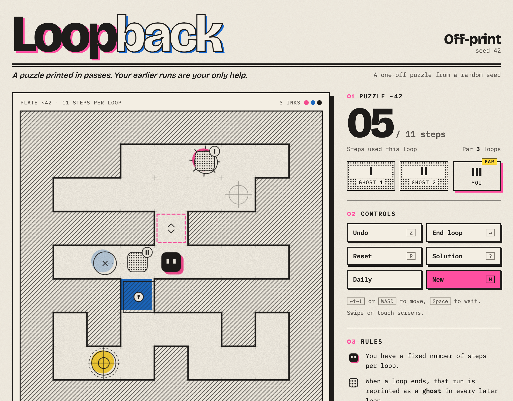

# Loopback

**A daily time-loop puzzle where your past selves are your only teammates.**



**[Play today's puzzle in your browser →](https://thewingthewong.github.io/loopback/)** · no install, no sign-up

You get a fixed number of steps per loop. When the loop ends, your run becomes a
**ghost** that replays it exactly, and a fresh you starts over. Ghosts standing on
pressure plates hold the matching doors open, so you plan one run to help a future one.
Every puzzle is procedurally generated and **proven solvable** by a built-in solver.

Zero dependencies: plain HTML, CSS and ES modules, with no build step.

## Run it

```sh
npm start            # http://127.0.0.1:8080
```

Any static file server works too, because the game is just files.
`?seed=123` in the URL gives a specific puzzle. With no seed you get the daily puzzle
(the same for everyone, keyed off the UTC date).

## Controls

| Key | Action |
| --- | --- |
| Arrow keys / WASD (or swipe) | move |
| Space | wait one step |
| Z / Backspace | undo (works across loops) |
| Enter | end the loop now (wait out the rest) |
| R / N | reset / new random puzzle |

Winning gives a shareable result:

```
Loopback #324
👻👻🤖 3/3 loops ⭐
32 moves
```

## How it works

- **`src/engine.js`**: pure, deterministic game logic shared by the browser and the tests.
  - *Rules*: the door state at time `t` comes from every entity's position at `t`. Ghosts replay
    their **positions**, not their inputs, so a later loop can never cause a paradox.
  - *Solver*: a plate **schedule** is a bitset (`bit t·P+k` = plate *k* held at step *t*).
    Opening a door never blocks anything, so a schedule that holds plates at more times is
    always at least as useful. The solver therefore keeps only non-dominated (Pareto-maximal)
    schedules for each cell and time step, and runs a breadth-first search over
    combined ghost schedules, one level per loop. The last loop is a plain breadth-first
    search over (cell, time).
  - *Generator*: seeded (mulberry32). It splits the board with walls that each have one door,
    scatters obstacles, and places plates, then randomly flips or transposes the board. If
    one loop is enough, the level is rejected. Solvability can only improve as the loop gets
    longer (extra steps can be spent waiting), so it binary-searches the tightest loop
    length and adds 1–2 steps of slack. Levels that exceed the solver's work budget are discarded.
- **`src/ui.js` + `index.html`**: art-directed as a **risograph-printed puzzle book**. It uses
  three spot inks (pink, blue, black) printed with `multiply` blending and slight misregistration,
  hatched walls, halftone ghosts (your earlier runs, reprinted), a registration-mark exit, and paper grain.
  The UI is laid out like a magazine page (masthead, numbered sections, hard offset shadows),
  set in Bricolage Grotesque and IBM Plex Mono (bundled in `fonts/`, OFL). A **plate timeline**
  shows exactly which steps your ghosts hold each plate, so you can time your run. Respects
  `prefers-reduced-motion`.
- **`serve.mjs`**: a tiny static file server.

## Test it

```sh
npm test             # engine unit tests (node:test, no install needed)
npm install          # once, for Playwright
npx playwright install chromium
npm run test:e2e     # headless Chromium plays the solver's solution via the keyboard
```

The unit tests generate 100 puzzles and check that every one is solvable, needs at least two
loops, and that the solver's solution replays to a win. The browser test plays real puzzles
through keyboard input. `node scripts/screenshot.mjs` regenerates the screenshot above.

## Limitations

- Puzzles use **at most three loops**. The solver's search grows quickly with each extra loop, so
  generation stays within a fixed work budget and discards levels that go over it. Larger, deeper
  puzzles aren't generated.
- Nothing is saved: no streaks, history or settings survive a reload.
- The board is drawn on a canvas. It plays fine with the keyboard, but screen readers can't follow it.
- The daily puzzle changes at 00:00 UTC, which is mid-day for some time zones.

## License

[MIT](LICENSE). The bundled fonts are under the SIL Open Font License 1.1 (see [`fonts/README.md`](fonts/README.md)).
